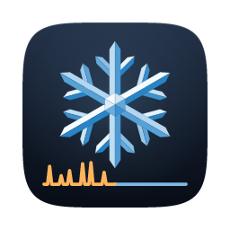
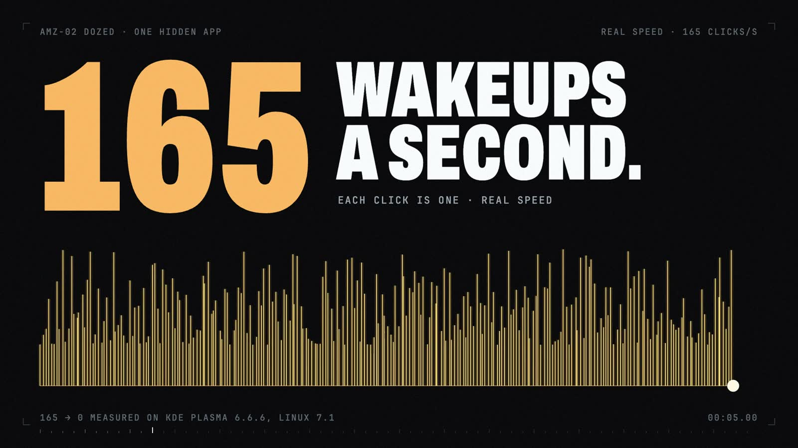

<div align="center">

<a href="https://amazynk.com/dozed/"></a>

<h1>Dozed</h1>

<p>
  Freezes backgrounded desktop applications so they stop waking the CPU, and thaws them the instant you switch back.
  <br>
  Free and open source, for Linux. Unprivileged, and dry-run by default.
</p>

<p>
  <a href="https://amazynk.com/dozed/">Website</a>
  ·
  <a href="#why-you-might-trust-it">Why trust it</a>
  ·
  <a href="#install">Install</a>
  ·
  <a href="#using-it">Using it</a>
  ·
  <a href="#configuration">Configuration</a>
  ·
  <a href="DESIGN.md">Design</a>
  ·
  <a href="CONTRIBUTING.md">Contributing</a>
</p>

<p>
  <a href="https://github.com/amazynk/dozed/actions/workflows/ci.yml"></a>
  <a href="#license"></a>
  <a href="#what-you-need"></a>
  <a href="https://amazynk.com/discord/"></a>
</p>

</div>

<p align="center">
  <a href="https://amazynk.com/dozed/#film"></a>
  <br>
  <sub>A frame from <a href="https://amazynk.com/dozed/#film">the 30-second film</a>. The 165 wakeups a second, and the 0 that follows, are measured on KDE Plasma 6.6.6 and Linux 7.1.</sub>
</p>

`dozed` is a daemon for the Linux desktop: Wayland (KDE, GNOME, Sway) and X11. The website,
[amazynk.com/dozed](https://amazynk.com/dozed/), shows it at work.

A hidden Slack that wakes the CPU 900 times a second is burning power on nothing. `dozed`
notices, waits out a grace period, and stops it — then gets out of the way before you can
tell.

**The target is wasteful software, not a short battery.** That app wastes the same power
plugged in as unplugged, so dozed works on a charger and on a desktop too. It is twice as
patient on mains, and on battery its grace shrinks with the charge left.

## Why you might trust it

* **It does nothing until you say so.** The default mode is `dry-run`: it records what it
  *would* have done and touches nothing, and `dozectl report` tells you what that would have
  been worth.
* **It can prove it, or admit it cannot.** `dozectl trial` runs a randomised experiment on
  your own machine and reports a saving with a confidence interval, or "no measurable
  difference".
* **Every action maps to one named rule.** `dozectl why slack` always answers, including
  when the answer is "nothing happened, and here is which rule was counting down".
* **It shows its own cost.** `dozectl status` reports the daemon's own wakeups per second.
* **It leaves alone anything somebody else can hear or see.** An app playing audio, holding
  the microphone or the camera, or sharing the screen is never touched.
* **It says what it cannot see.** `dozectl status` reports, for each of those signals,
  whether it is reporting, unavailable here, or degraded because a utility is missing, and
  names the package.

## What you need

* Linux with a systemd user session and cgroup v2, which every current desktop distribution
  has.
* Rust 1.90 or newer, from [rustup](https://rustup.rs). There is no packaged release yet:
  0.1 installs from source, and builds in a few minutes.
* One of these sessions:

| Session | How dozed sees your windows | Extra piece |
|---|---|---|
| KDE Plasma on Wayland | a KWin script that reports to the daemon | installed for you |
| GNOME 45 to 49 on Wayland | a Shell extension that reports to the daemon | installed for you |
| Sway, i3 | the window manager's own IPC | none |
| X11, any desktop | EWMH, read in-process | none |

Hyprland and niri are not supported yet. Sway and X11 are exercised by
`packaging/verify-matrix.sh` against real compositors; GNOME cannot be arranged from a
script, so it is not in that check.

## Install

```sh
git clone https://github.com/amazynk/dozed.git
cd dozed
./packaging/install.sh          # builds, installs binaries, unit and compositor helper
systemctl --user enable --now dozed.service
```

That also installs `man dozed` and `man dozectl`, shell completions for bash, zsh and fish,
and a desktop entry for the dashboard. All of it goes under `$HOME` — nothing here wants
root — and `./packaging/install.sh --uninstall` takes every piece back out while leaving
your config and recorded sessions alone. `--no-build` installs what is already in
`target/release`; `--no-restart` leaves a running daemon on its old binary; `--no-helper`
leaves your compositor's own configuration untouched.

It starts in dry-run. Leave it for a day, read `dozectl report`, and switch over when the
number convinces you:

```sh
dozectl mode live               # or edit ExecStart in the unit, deliberately
```

## Using it

| Command | |
|---|---|
| `dozectl status` | mode, what is held, the daemon's own cost |
| `dozectl watch` | decisions as they happen, this run only (`--all` for history) |
| `dozectl why <app>` | why this app is in the state it is in; `--rules` for the misses too |
| `dozectl report` | what dozing saved, or would have — modelled, and measured if you have run a trial |
| `dozectl trial` | measure whether it actually saves anything, by experiment |
| `dozectl suggest` | search your own recorded day for a better config than the one you run |
| `dozectl export` | the same numbers as Prometheus metrics, for graphing a week of them |
| `dozectl upgrade-presets` | rules a later version ships that your config predates |
| `dozectl snooze 1h` | stop acting for a while, then carry on by itself (`--off` to end early) |
| `dozectl thaw --all` | panic button: restore everything, ignore rules, ignore mode |

There is a tray icon too, showing what is held, with the panic thaw and the snooze one click
away. `dozed-gui` is the dashboard: the same picture in a window, and every setting with its
explanation beside it. dozed sends one notification a week, saying what dozing has been
worth, and no others.

[docs/using.md](docs/using.md) covers snooze, the trial, tuning from a recorded day, and
what to run after an upgrade.

## Configuration

Configuration lives in `~/.config/dozed/config.toml`, written on first install. The file is
also the reference: every section and field is explained where it appears. One setting
decides how hard dozed tries:

```toml
[defaults]
aggression = "balanced"     # gentle | balanced | aggressive | maximum
```

What each means for the catch-all rule, which is what most apps hit:

| | on battery | plugged in |
|---|---|---|
| `gentle` | 15m | 30m |
| `balanced` | 5m | 10m |
| `aggressive` | 2m | 4m |
| `maximum` | 45s | 1m30s |

What happens to an app is decided by rules: first match wins, by explicit priority, and
deliberately not a scripting language — that constraint is what makes `dozectl why`
answerable. `dozed --check` validates a config and prints the effective rule table.
[docs/configuration.md](docs/configuration.md) has the rules, the actions and the
predicates.

## CPU power

`dozectl status` and the dashboard can also show what the processor itself is spending, from
the CPU's own energy counter (RAPL). The kernel has kept that counter readable by root only
since CVE-2020-8694, because it is fine-grained enough to be a side channel, and dozed does
not ask for it: where it cannot be read, the figure is absent and nothing else changes.
[docs/cpu-power.md](docs/cpu-power.md) says what the counter buys, how to open it to one
group, and how to undo that.

## Building

```sh
cargo test --workspace
```

Five crates: `dozed-core` is the pure domain logic, with no I/O, no syscalls and no clock;
`dozed-linux` is everything OS-specific, behind traits from core; `dozed` is the daemon,
`dozectl` the CLI and `dozed-gui` the egui dashboard.

[DESIGN.md](DESIGN.md) is the long form: why each decision is what it is, and the
measurements behind it. It is worth reading before changing behaviour — most of the
non-obvious choices are there because the obvious one was tried first and recorded when it
failed.

## Status

This is 0.1, the first public release, and it comes out of weeks of daily use. Every
measurement in `DESIGN.md` comes from one or two machines, and its §16 records what was
verified against a live session or a real kernel and what was not. If yours behaves
differently, `packaging/collect-evidence.sh` gathers what an issue needs.

## Contributing

Chat is on [Discord](https://amazynk.com/discord/), and bugs and requests go to
[issues](https://github.com/amazynk/dozed/issues/new/choose). Before
sending a change, read [CONTRIBUTING.md](CONTRIBUTING.md), and `DESIGN.md` for the section
your change touches. Please report security problems privately, as described in
[SECURITY.md](SECURITY.md). For anything else, write to
[help@amazynk.com](mailto:help@amazynk.com).

## License

Dozed is licensed under the [MIT License](LICENSE). Unless you explicitly state otherwise,
any contribution you submit for inclusion in Dozed is licensed the same way, without any
additional terms or conditions.

<br>

<div align="center">
<sub>Made by the team behind <a href="https://zynk.it">Zynk</a> · <a href="https://amazynk.com">amazynk</a></sub>
</div>
